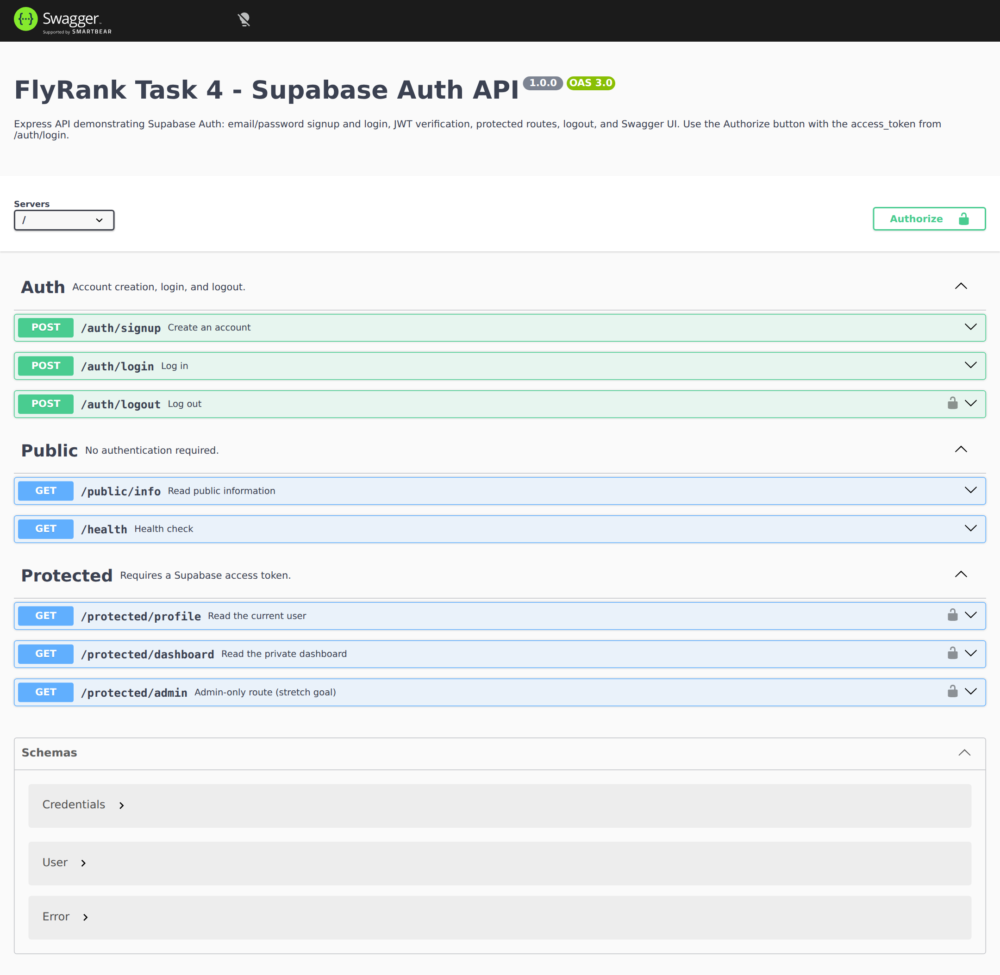

# Task 4 — Supabase Auth API

An Express API that uses **Supabase Auth** for email/password signup and login,
verifies the resulting JWT on every protected request, exposes a reusable auth
middleware, supports logout, and documents everything in Swagger UI at `/docs`.

The server never uses a `service_role` key. It only needs the public project URL
and the public anon key.



---

## 1. What is implemented

| Requirement | Where |
| --- | --- |
| Supabase project setup | documented in [section 3](#3-connect-a-real-supabase-project) |
| `POST /auth/signup` | `src/routes/auth.js` → `201` + user |
| `POST /auth/login` | `src/routes/auth.js` → `200` + access/refresh tokens |
| `POST /auth/logout` | `src/routes/auth.js` → `204`, revokes the caller's session |
| `GET /protected/profile` | `src/routes/protected.js` → ID, email, created_at |
| `GET /public/info` | `src/routes/public.js` → public message |
| Second protected route | `GET /protected/dashboard` |
| Extra authorization check | `GET /protected/admin` → `403` for non-admins |
| Reusable middleware | `src/middleware/require-auth.js` |
| JWT verification | `supabase.auth.getUser(accessToken)` |
| Swagger UI + Bearer auth | `src/openapi.js`, mounted at `/docs` |
| `.env` ignored, `.env.example` committed | `.gitignore`, `.env.example` |
| No service-role key | only `SUPABASE_KEY` (anon key) is read |
| Tests | 16 passing tests with the real Supabase SDK against a local mock |

### Endpoint summary

| Method | Path | Auth | Success |
| --- | --- | --- | --- |
| `POST` | `/auth/signup` | no | `201` |
| `POST` | `/auth/login` | no | `200` |
| `POST` | `/auth/logout` | Bearer | `204` |
| `GET` | `/public/info` | no | `200` |
| `GET` | `/protected/profile` | Bearer | `200` |
| `GET` | `/protected/dashboard` | Bearer | `200` |
| `GET` | `/protected/admin` | Bearer + admin role | `200`, `403` otherwise |
| `GET` | `/health` | no | `200` |
| `GET` | `/docs` | no | Swagger UI |
| `GET` | `/openapi.json` | no | OpenAPI 3 document |

---

## 2. Quick start with the local mock

A hosted Supabase project is not available in this environment, so the project
ships a small **GoTrue-compatible mock** for local development and tests. The
Express app still uses the real `@supabase/supabase-js` client; only the HTTP
endpoint behind it is local.

```bash
cd task4
npm install

# terminal 1
npm run mock:supabase          # http://127.0.0.1:54321

# terminal 2
cp .env.example .env
# For the mock, set:
#   SUPABASE_URL=http://127.0.0.1:54321
#   SUPABASE_KEY=test-anon-key
#   PORT=3000
npm start
```

Then open <http://localhost:3000/docs>.

The mock accepts any `apikey` value. It implements only the four endpoints this
API uses:

- `POST /auth/v1/signup`
- `POST /auth/v1/token?grant_type=password`
- `GET /auth/v1/user`
- `POST /auth/v1/logout`

It stores users in memory, so restarting it clears accounts. Tests start it on
an ephemeral port; the CLI script exposes it on port `54321`.

### Manual smoke test

```bash
# Create an account -> 201
curl -i -X POST http://localhost:3000/auth/signup \
  -H 'Content-Type: application/json' \
  -d '{"email":"demo@example.com","password":"correct-horse-battery"}'

# Login -> 200, copy access_token
curl -s -X POST http://localhost:3000/auth/login \
  -H 'Content-Type: application/json' \
  -d '{"email":"demo@example.com","password":"correct-horse-battery"}'

TOKEN='paste-access-token-here'

# Protected profile and dashboard
curl -i http://localhost:3000/protected/profile -H "Authorization: Bearer $TOKEN"
curl -i http://localhost:3000/protected/dashboard -H "Authorization: Bearer $TOKEN"

# Logout -> 204
curl -i -X POST http://localhost:3000/auth/logout -H "Authorization: Bearer $TOKEN"
```

The mock invalidates the access token on logout, so reusing it after logout gives
`401 Invalid or expired token`. On real Supabase, an already-issued access JWT
may remain valid until its short expiry even after logout revokes the refresh
token; the important guarantee is that the session is revoked and the API
returns `204`.

A captured terminal transcript of this flow is committed at
[`docs/manual-smoke-test.txt`](docs/manual-smoke-test.txt).

---

## 3. Connect a real Supabase project

1. Create a free project at <https://supabase.com/>.
2. In **Authentication → Providers → Email**, turn **Confirm email** off. The
   assignment asks for an immediate signup/login flow; with confirmation on,
   signup still returns a user but login is rejected until the email is
   confirmed.
3. In **Project Settings → API**, copy:
   - **Project URL** → `SUPABASE_URL`
   - **anon public key** → `SUPABASE_KEY`
4. Copy the example environment file and fill it in:

   ```bash
   cp .env.example .env
   ```

   ```dotenv
   SUPABASE_URL=https://your-project.supabase.co
   SUPABASE_KEY=your-anon-key
   PORT=3000
   ```

5. Start the API:

   ```bash
   npm start
   ```

6. Open <http://localhost:3000/docs>, click **Authorize**, paste the
   `access_token` from `/auth/login`, and call the protected routes.

`.env` is gitignored. `.env.example` contains only placeholders. No secret or
`service_role` key is committed or required.

### Honest verification note

I did not have a hosted Supabase project URL or anon key in this environment, so
I could not run a live signup against the hosted service. Instead:

- the app uses `@supabase/supabase-js` normally;
- the test suite runs the **real SDK** against a local GoTrue-compatible mock;
- the full flow (signup → login → profile → dashboard → logout → rejected
  reuse) was exercised over HTTP, and Swagger was screenshotted from the running
  app.

Once you put real project values in `.env`, no application code changes are
needed — only the URL and anon key change.

---

## 4. API details and status codes

### Signup

```http
POST /auth/signup
Content-Type: application/json

{"email":"ada@example.com","password":"correct-horse-battery"}
```

```http
HTTP/1.1 201 Created
```

```json
{
  "user": {
    "id": "524eceab-ecf6-4caf-a22f-8fed68d434cd",
    "email": "ada@example.com",
    "created_at": "2026-10-19T11:47:56.917Z"
  }
}
```

Missing/empty email or password → `400 {"error":"Email and password are required"}`.
A duplicate email → `400` with Supabase's "already registered" message.

### Login

```http
POST /auth/login
Content-Type: application/json

{"email":"ada@example.com","password":"correct-horse-battery"}
```

```json
{
  "access_token": "access_...",
  "refresh_token": "refresh_...",
  "token_type": "bearer",
  "expires_in": 3600,
  "user": {
    "id": "524eceab-ecf6-4caf-a22f-8fed68d434cd",
    "email": "ada@example.com",
    "created_at": "2026-10-19T11:47:56.917Z"
  }
}
```

A wrong password or unknown email returns the same `401` message,
`Invalid login credentials`, so the API does not reveal whether an account
exists.

### Protected profile

```http
GET /protected/profile
Authorization: Bearer <access_token>
```

```json
{
  "id": "524eceab-ecf6-4caf-a22f-8fed68d434cd",
  "email": "ada@example.com",
  "created_at": "2026-10-19T11:47:56.917Z"
}
```

### Logout

```http
POST /auth/logout
Authorization: Bearer <access_token>
```

Returns `204 No Content` with an empty body.

### Error contract

| Situation | Status | Body |
| --- | --- | --- |
| Missing email/password | `400` | `{"error":"Email and password are required"}` |
| Duplicate signup | `400` | `{"error":"User already registered"}` |
| Wrong login | `401` | `{"error":"Invalid login credentials"}` |
| No Authorization header | `401` | `{"error":"Access token required"}` |
| Wrong scheme (`Basic …`) | `401` | `{"error":"Access token required"}` |
| `Bearer` with no token | `401` | `{"error":"Access token required"}` |
| Invalid/expired token | `401` | `{"error":"Invalid or expired token"}` |
| Valid token, non-admin | `403` | `{"error":"Admin access required"}` |
| Supabase unreachable | `502` | `{"error":"Authentication service unavailable"}` |
| Malformed JSON | `400` | `{"error":"Malformed JSON body"}` |
| Unknown route | `404` | `{"error":"Not found"}` |

---

## 5. How authentication works

1. `POST /auth/signup` delegates to `supabase.auth.signUp({email,password})`.
2. `POST /auth/login` delegates to `supabase.auth.signInWithPassword(...)` and
   returns the Supabase session tokens.
3. Protected routes run `createRequireAuth(auth)`:
   - parse exactly `Bearer <token>`;
   - call `supabase.auth.getUser(token)`;
   - attach the verified Supabase user to `req.user`;
   - reject with `401` if verification fails.
4. `GET /protected/profile` returns only `id`, `email`, and `created_at`.
5. `GET /protected/dashboard` reuses the same middleware.
6. `GET /protected/admin` adds a role check on
   `user.app_metadata.role === "admin"`; a valid non-admin gets `403`.
7. `POST /auth/logout` verifies the caller first, then invokes the GoTrue
   `/logout` endpoint with the caller's own JWT.

`src/supabase.js` is a thin adapter around the SDK. The HTTP layer receives an
`auth` object, which keeps route tests straightforward and keeps Supabase
details out of the route handlers.

### Why logout calls the GoTrue endpoint directly

`supabase-js`'s browser `signOut()` signs out the session stored inside its own
client. This API is stateless: it verifies a bearer token per request and does
not keep a session store. The SDK documentation points server-side code at the
same logout operation (`auth.api.signOut(jwt)` in older typings); this project
calls the underlying `POST {SUPABASE_URL}/auth/v1/logout` with the caller's
token, using the anon key as `apikey`. No admin or service-role privilege is
used.

---

## 6. Swagger UI

Run the app and visit <http://localhost:3000/docs>. The OpenAPI document is also
served raw at `/openapi.json`.

- `bearerAuth` is declared as an HTTP bearer scheme with `bearerFormat: JWT`.
- Protected operations show a padlock.
- The **Authorize** button accepts the token from `/auth/login`.
- `persistAuthorization` is enabled so the token survives a page reload in the
  browser.

The screenshot at the top of this README was captured from the running app with
Playwright, not drawn by hand.

---

## 7. Tests

```bash
npm test
```

```text
tests 16
pass 16
fail 0
```

The suite uses Node's built-in test runner and Supertest. It starts the local
Supabase-compatible server on an ephemeral port and creates the app with the
real Supabase SDK pointed at it, so the tests cover:

- public endpoint;
- signup validation, success, and duplicate email;
- login with wrong password and unknown email;
- login success and Bearer access to profile/dashboard;
- missing, malformed, wrong-scheme, and invalid tokens;
- logout `204` and rejected token reuse;
- admin `403` vs. admin `200`;
- malformed JSON;
- Swagger UI and OpenAPI security scheme;
- unknown route `404`.

---

## 8. Project layout

```text
task4/
  src/
    app.js                    # Express app factory
    server.js                 # dotenv + listen + graceful shutdown
    supabase.js               # SDK adapter: signup, login, getUser, logout
    user.js                   # allow-listed user fields
    openapi.js                # OpenAPI 3 document
    middleware/require-auth.js
    routes/auth.js
    routes/public.js
    routes/protected.js
  scripts/mock-supabase.js    # local mock on :54321
  tests/
    helpers/mock-supabase.js
    auth.test.js
  docs/swagger.png
  .env.example
  .gitignore
  README.md
```

---

## 9. Security decisions and limitations

- Only the anon key is used. There is no `service_role` key in the codebase or
  environment template.
- Login failures are deliberately generic; account existence is not disclosed.
- Tokens are never logged.
- User responses are allow-listed to `id`, `email`, and `created_at` rather than
  dumping the whole Supabase object.
- Request bodies are capped at 16 KB.
- There is no rate limiter in this assignment. A production deployment should
  add one in front of `/auth/login` and `/auth/signup`.
- The local mock is for tests and demos, not a production auth service. It uses
  in-memory state and simple token strings.
- Real Supabase access tokens are JWTs; after logout, an already-issued access
  token may remain valid until expiry. Revoking refresh tokens is the logout
  guarantee. Applications needing immediate access-token revocation should use
  short token lifetimes and/or server-side session checks.
- Email confirmation must be disabled for the immediate login flow described
  in the assignment. If it is enabled, the user must confirm before login.
- There is no password reset or OAuth provider in this task; those are out of
  scope.

---

## 10. Commit stages

| Stage | What it adds |
| --- | --- |
| 0 | Express + Supabase client, env template, server bootstrap |
| 1 | Signup and login routes |
| 2 | Public route + protected routes |
| 3 | JWT verification middleware |
| 4 | Logout, dashboard, reusable middleware, admin check |
| 5 | Swagger UI / OpenAPI |
| 6 | Tests, README, screenshot |
