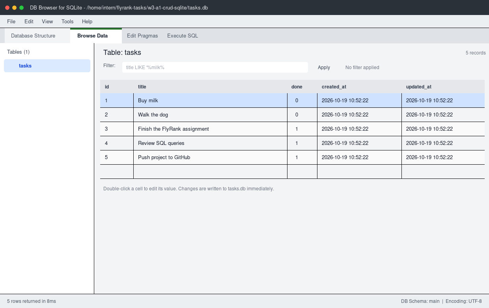

# Week 3 · Assignment 1 — CRUD API with SQLite

A REST API for managing tasks, built with **Node.js**, **Express**, and **SQLite**.
It exposes the same CRUD endpoints as the Week 2 assignment, but tasks now live in
a real database instead of an in-memory array. **Data survives a server restart.**

## Why SQLite?

- **Zero setup** — no database server to install or run. The `better-sqlite3`
  package talks to a single local file.
- **Persistent** — every write is committed to disk, so restarting the server no
  longer wipes the task list.
- **Transactional and relational** — it is real SQL, so the project can grow
  without changing the API.
- **Perfect for this assignment** — one developer, one server, and a small data
  set. Moving to PostgreSQL later would only mean replacing the repository layer.

## Architecture

```text
Client  ->  Express API  ->  tasks repository (SQL)  ->  SQLite file (tasks.db)
```

The HTTP layer knows nothing about SQL. All queries live in
[`src/tasks-repo.js`](src/tasks-repo.js); the API in [`src/app.js`](src/app.js)
only validates requests and shapes responses. That separation is why the API did
not change when the storage layer did.

## Requirements

- Node.js **20.19+** (tested with Node 24)
- npm

SQLite itself does not need to be installed.

## Getting started

```bash
cd w3-a1-crud-sqlite
npm install
npm start
```

The server starts on <http://localhost:3000>. On the first run it automatically:

1. creates `tasks.db` if the file is missing,
2. creates the `tasks` table if it is missing,
3. inserts three example tasks **once**.

Stop the server with `Ctrl+C`, start it again, and the tasks will still be there.

### Available scripts

| Command | Description |
| --- | --- |
| `npm start` | Start the API on port `3000` |
| `npm run dev` | Start with Node's watch mode (auto-restart) |
| `npm test` | Run the API test suite |
| `npm run init-db` | Create/seed the database and print the task count |
| `npm run sql -- "SELECT * FROM tasks;"` | Run an ad-hoc SQL query in the terminal |

### Configuration

| Variable | Default | Description |
| --- | --- | --- |
| `PORT` | `3000` | HTTP port |
| `DB_PATH` | `w3-a1-crud-sqlite/tasks.db` | Location of the SQLite file |

```bash
PORT=4000 DB_PATH=/tmp/demo.db npm start
```

## Where is the database stored?

The database file is:

```text
w3-a1-crud-sqlite/tasks.db
```

It is created next to `package.json` (not relative to the shell's working
directory) and is intentionally **not committed to Git** — anyone cloning the
repository gets a fresh database on their first run. Set `DB_PATH` to store it
somewhere else.

## Database schema

```sql
CREATE TABLE IF NOT EXISTS tasks (
  id         INTEGER PRIMARY KEY AUTOINCREMENT,
  title      TEXT    NOT NULL,
  done       INTEGER NOT NULL DEFAULT 0 CHECK (done IN (0, 1)),
  created_at TEXT    NOT NULL DEFAULT (strftime('%Y-%m-%dT%H:%M:%fZ', 'now')),
  updated_at TEXT    NOT NULL DEFAULT (strftime('%Y-%m-%dT%H:%M:%fZ', 'now'))
);
```

`done` is stored as SQLite's `0`/`1` and converted to a JSON boolean by the
repository. `created_at` and `updated_at` are optional-extra timestamps and are
returned as ISO 8601 strings.

A tiny `app_meta` table records that the examples have been seeded. Without it,
deleting every task and restarting would insert the examples again. This way the
three examples are inserted **only on the very first run**.

## API reference

Base URL: `http://localhost:3000`

| Method | Endpoint | Success | Errors |
| --- | --- | --- | --- |
| `GET` | `/tasks` | `200` array of tasks | — |
| `GET` | `/tasks/:id` | `200` task | `404` unknown id |
| `POST` | `/tasks` | `201` created task + `Location` | `400` invalid body |
| `PUT` | `/tasks/:id` | `200` updated task | `400`, `404` |
| `PATCH` | `/tasks/:id` | `200` updated task | `400`, `404` |
| `DELETE` | `/tasks/:id` | `204` no content | `404` unknown id |
| `GET` | `/stats` | `200` task counts | — |
| `GET` | `/health` | `200` `{ "status": "ok" }` | — |

A task looks like this:

```json
{
  "id": 1,
  "title": "Buy milk",
  "done": false,
  "created_at": "2026-10-19T10:52:22.682Z",
  "updated_at": "2026-10-19T10:52:22.682Z"
}
```

### List tasks

```bash
curl http://localhost:3000/tasks
```

Optional query parameters (implemented with SQL, not filtering in JavaScript):

| Query | Example | What it does |
| --- | --- | --- |
| `search` | `/tasks?search=milk` | `title LIKE '%milk%'` (wildcards are escaped) |
| `done` | `/tasks?done=true` | `WHERE done = 1`; accepts `true`/`false`/`1`/`0` |
| `sort` | `/tasks?sort=title` | `id` (default) or `title` (case-insensitive) |
| `order` | `/tasks?sort=title&order=desc` | `asc` (default) or `desc` |

Invalid parameter values return `400` with a JSON error, for example:

```json
{ "error": "Done must be true or false" }
```

### Get one task

```bash
curl http://localhost:3000/tasks/1
```

Unknown or malformed ids return `404`:

```json
{ "error": "Task not found" }
```

### Create a task

```bash
curl -X POST http://localhost:3000/tasks \
  -H "Content-Type: application/json" \
  -d '{"title":"Write the README","done":false}'
```

- `title` is required and must be a non-empty string (it is trimmed).
- `done` is optional and defaults to `false`; it must be a boolean.
- Missing/blank title returns `400`:

```json
{ "error": "Title is required" }
```

A malformed JSON body also returns `400` with `{ "error": "Invalid JSON body" }`.

### Update a task

```bash
curl -X PUT http://localhost:3000/tasks/1 \
  -H "Content-Type: application/json" \
  -d '{"title":"Buy oat milk","done":true}'
```

`PUT` can update `title`, `done`, or both. `PATCH` is accepted as an alias. An
empty body returns `400`, and an unknown id returns `404`.

### Delete a task

```bash
curl -X DELETE http://localhost:3000/tasks/1
```

Returns `204 No Content` on success, or `404` if the task does not exist.

### Statistics

```bash
curl http://localhost:3000/stats
```

```json
{ "total": 5, "completed": 3, "pending": 2 }
```

The counts come from SQLite (`COUNT(*)` and `SUM(done)`), not from loading every
task into Node.

## Exploring the database with SQL

Open `tasks.db` in [DB Browser for SQLite](https://sqlitebrowser.org/) or use the
project's helper:

```bash
npm run sql -- "SELECT * FROM tasks;"
npm run sql -- "SELECT COUNT(*) AS total_tasks FROM tasks;"
```

The complete set of practice queries is in [`sql/queries.sql`](sql/queries.sql):

```sql
SELECT * FROM tasks;                          -- every task
SELECT * FROM tasks WHERE done = 1;           -- completed only
SELECT COUNT(*) AS total_tasks FROM tasks;    -- count
UPDATE tasks SET done = 1;                    -- mark everything completed
DELETE FROM tasks WHERE done = 1;             -- delete completed tasks
```

Example result of `SELECT * FROM tasks;`:

```text
┌─────────┬────┬─────────────────────────────────┬──────┬────────────────────────────┬────────────────────────────┐
│ (index) │ id │ title                           │ done │ created_at                 │ updated_at                 │
├─────────┼────┼─────────────────────────────────┼──────┼────────────────────────────┼────────────────────────────┤
│ 0       │ 1  │ 'Buy milk'                      │ 0    │ '2026-10-19T10:52:22.682Z' │ '2026-10-19T10:52:22.682Z' │
│ 1       │ 2  │ 'Walk the dog'                  │ 0    │ '2026-10-19T10:52:22.682Z' │ '2026-10-19T10:52:22.682Z' │
│ 2       │ 3  │ 'Finish the FlyRank assignment' │ 1    │ '2026-10-19T10:52:22.682Z' │ '2026-10-19T10:52:22.682Z' │
│ 3       │ 4  │ 'Review SQL queries'            │ 1    │ '2026-10-19T10:52:22.799Z' │ '2026-10-19T10:52:22.799Z' │
│ 4       │ 5  │ 'Push project to GitHub'        │ 1    │ '2026-10-19T10:52:22.917Z' │ '2026-10-19T10:52:22.917Z' │
└─────────┴────┴─────────────────────────────────┴──────┴────────────────────────────┴────────────────────────────┘
```

Change a row manually, call `GET /tasks`, and the API immediately reflects the
change — both layers are looking at the same file.

### Database screenshot



## Tests

```bash
npm test
```

The suite uses Node's built-in test runner and Supertest. Every test creates an
isolated temporary database. Coverage includes:

- schema creation and one-time seeding (including after all tasks are deleted),
- reads from SQLite, unknown ids, and invalid ids,
- creation with validation and persistence across a restart,
- updates, partial updates, validation, and persistence,
- deletion and `404` behaviour,
- search, done filtering, sorting, query validation, and `/stats`.

## Project structure

```text
w3-a1-crud-sqlite/
├── docs/
│   └── database-viewer.png   # screenshot used in this README
├── scripts/
│   ├── init-db.js            # create + seed the database
│   └── run-sql.js            # run a SQL query from the terminal
├── sql/
│   └── queries.sql           # practice queries from Stage 4
├── src/
│   ├── app.js                # Express routes and request validation
│   ├── db.js                 # connection, schema, one-time seed
│   ├── server.js             # HTTP server and graceful shutdown
│   └── tasks-repo.js         # every SQL statement lives here
├── tests/
│   └── api.test.js
├── package.json
└── tasks.db                  # created automatically, ignored by Git
```

## Assignment checklist

- [x] Tasks stored in SQLite instead of memory
- [x] Data survives server restarts
- [x] Database file created automatically when missing
- [x] `tasks` table created automatically when missing
- [x] Three example tasks inserted only on the first run
- [x] CRUD operations use SQL queries
- [x] Same CRUD endpoints and response shapes as Assignment 1
- [x] Unknown ids return `404`
- [x] Invalid requests return `400`
- [x] README with SQLite rationale, database location, run instructions,
      screenshot, and example SQL query
- [x] Optional extras: SQL search, done filter, sorting, `/stats`, timestamps
